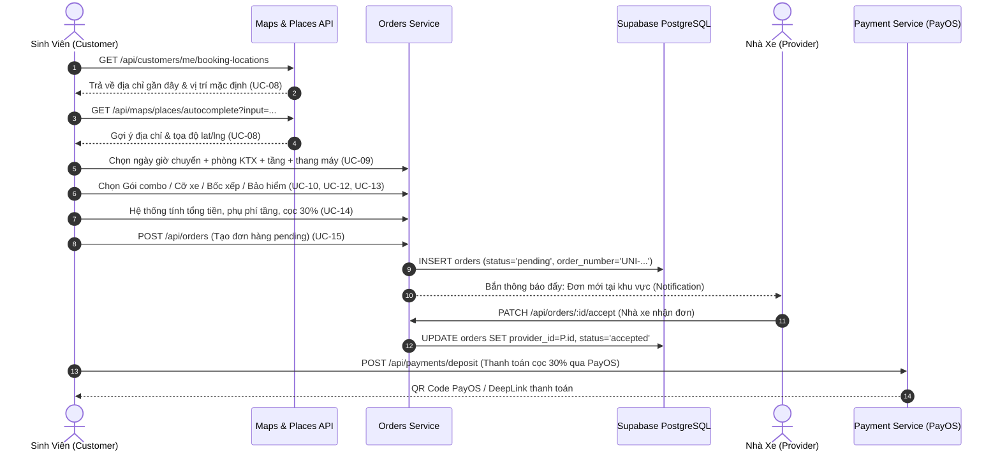
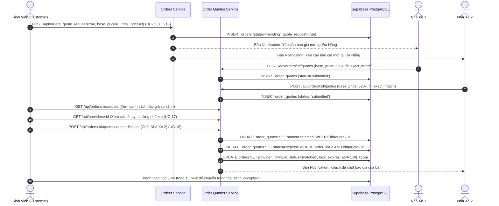

# 🚚 Phân Hệ: Tìm Kiếm & Thiết Lập Dịch Vụ Vận Chuyển (Backend Architecture)

> **Thành viên phụ trách:** Thành  
> **Tên phân hệ:** Tìm kiếm và thiết lập dịch vụ vận chuyển  
> **Danh sách chức năng:** STT 7 → 17 (Browse Transport Providers, Enter Pickup/Delivery Addresses, Select Move Schedule & Dorm Details, Select Service Package, Enter Item & Move Details, Select Cargo Insurance, Book Labor Service, View Estimated Price, Create Transport Order, Accept Provider Quote, View Provider Detail)

---

## 📋 Bảng Tổng Hợp 11 Chức Năng

| STT | Tên Chức Năng (Feature) | Use Case ID | API Endpoint & Method | File Route / Controller / Service | Database / Schema |
|:---:|:---|:---:|:---|:---|:---|
| **7** | **Browse Transport Providers** | UC-07 | `GET /api/providers/browse` | [providers.routes.js](file:///c:/Users/Admin/Documents/PRM/BeeUniOld/wdp301-rbl-project-wdp_se18d08_group-4/backend/src/routes/providers.routes.js#L8)<br>[providers.controller.js](file:///c:/Users/Admin/Documents/PRM/BeeUniOld/wdp301-rbl-project-wdp_se18d08_group-4/backend/src/controllers/providers.controller.js#L3-L14)<br>[providers.service.js](file:///c:/Users/Admin/Documents/PRM/BeeUniOld/wdp301-rbl-project-wdp_se18d08_group-4/backend/src/services/providers.service.js#L31-L59) | `provider_profiles`, `profiles` |
| **8** | **Enter Pickup and Delivery Addresses** | UC-08 | `GET /api/maps/places/autocomplete`<br>`GET /api/maps/places/details`<br>`GET /api/maps/places/resolve`<br>`GET /api/customers/me/recent-places`<br>`GET /api/customers/me/booking-locations` | [maps.routes.js](file:///c:/Users/Admin/Documents/PRM/BeeUniOld/wdp301-rbl-project-wdp_se18d08_group-4/backend/src/routes/maps.routes.js#L7-L25), [customers.routes.js](file:///c:/Users/Admin/Documents/PRM/BeeUniOld/wdp301-rbl-project-wdp_se18d08_group-4/backend/src/routes/customers.routes.js#L12-L15)<br>[maps.controller.js](file:///c:/Users/Admin/Documents/PRM/BeeUniOld/wdp301-rbl-project-wdp_se18d08_group-4/backend/src/controllers/maps.controller.js), [customers.controller.js](file:///c:/Users/Admin/Documents/PRM/BeeUniOld/wdp301-rbl-project-wdp_se18d08_group-4/backend/src/controllers/customers.controller.js#L22-L58)<br>[maps.service.js](file:///c:/Users/Admin/Documents/PRM/BeeUniOld/wdp301-rbl-project-wdp_se18d08_group-4/backend/src/services/maps.service.js), [customers.service.js](file:///c:/Users/Admin/Documents/PRM/BeeUniOld/wdp301-rbl-project-wdp_se18d08_group-4/backend/src/services/customers.service.js#L385-L448) | `profiles.saved_recent_places`, `orders` (lịch sử địa chỉ) |
| **9** | **Select Move Schedule and Dorm Details** | UC-09 | `POST /api/orders` | [orders.routes.js](file:///c:/Users/Admin/Documents/PRM/BeeUniOld/wdp301-rbl-project-wdp_se18d08_group-4/backend/src/routes/orders.routes.js#L11)<br>[orders.controller.js](file:///c:/Users/Admin/Documents/PRM/BeeUniOld/wdp301-rbl-project-wdp_se18d08_group-4/backend/src/controllers/orders.controller.js#L24-L31)<br>[orders.service.js](file:///c:/Users/Admin/Documents/PRM/BeeUniOld/wdp301-rbl-project-wdp_se18d08_group-4/backend/src/services/orders.service.js#L89-L95) | `orders` (`scheduled_pickup_time`, `pickup_floor`, `delivery_floor`, `pickup_has_elevator`, `dorm_image_urls`) |
| **10** | **Select Service Package** | UC-10 | `GET /api/providers/:id`<br>`POST /api/orders` | [providers.routes.js](file:///c:/Users/Admin/Documents/PRM/BeeUniOld/wdp301-rbl-project-wdp_se18d08_group-4/backend/src/routes/providers.routes.js#L32), [orders.routes.js](file:///c:/Users/Admin/Documents/PRM/BeeUniOld/wdp301-rbl-project-wdp_se18d08_group-4/backend/src/routes/orders.routes.js#L11)<br>[providers.service.js](file:///c:/Users/Admin/Documents/PRM/BeeUniOld/wdp301-rbl-project-wdp_se18d08_group-4/backend/src/services/providers.service.js#L86-L103) (`mapServicePackage`)<br>[orders.service.js](file:///c:/Users/Admin/Documents/PRM/BeeUniOld/wdp301-rbl-project-wdp_se18d08_group-4/backend/src/services/orders.service.js#L43-L60) (`mapVehicleSize`) | `service_packages` (Economy, Standard, Premium), `orders.service_type` |
| **11** | **Enter Item and Move Details** | UC-11 | `POST /api/orders` | [orders.routes.js](file:///c:/Users/Admin/Documents/PRM/BeeUniOld/wdp301-rbl-project-wdp_se18d08_group-4/backend/src/routes/orders.routes.js#L11)<br>[orders.controller.js](file:///c:/Users/Admin/Documents/PRM/BeeUniOld/wdp301-rbl-project-wdp_se18d08_group-4/backend/src/controllers/orders.controller.js#L24-L31)<br>[orders.service.js](file:///c:/Users/Admin/Documents/PRM/BeeUniOld/wdp301-rbl-project-wdp_se18d08_group-4/backend/src/services/orders.service.js#L91-L104) | `orders.items` (JSONB), `orders.vehicle_size`, `orders.quote_request`, `orders.pickup_notes` |
| **12** | **Select Cargo Insurance** | UC-12 | `GET /api/providers/:id`<br>`POST /api/orders` | [providers.service.js](file:///c:/Users/Admin/Documents/PRM/BeeUniOld/wdp301-rbl-project-wdp_se18d08_group-4/backend/src/services/providers.service.js#L98) (`includes_insurance`)<br>[orders.service.js](file:///c:/Users/Admin/Documents/PRM/BeeUniOld/wdp301-rbl-project-wdp_se18d08_group-4/backend/src/services/orders.service.js#L109-L111) (`service_fee`) | `service_packages.includes_insurance`, `orders.service_fee` |
| **13** | **Book Labor Service** | UC-13 | `POST /api/orders` | [orders.routes.js](file:///c:/Users/Admin/Documents/PRM/BeeUniOld/wdp301-rbl-project-wdp_se18d08_group-4/backend/src/routes/orders.routes.js#L11)<br>[orders.service.js](file:///c:/Users/Admin/Documents/PRM/BeeUniOld/wdp301-rbl-project-wdp_se18d08_group-4/backend/src/services/orders.service.js#L132) & [L319-L320](file:///c:/Users/Admin/Documents/PRM/BeeUniOld/wdp301-rbl-project-wdp_se18d08_group-4/backend/src/services/orders.service.js#L319-L320) | `orders.requires_helpers`, `orders.number_of_helpers`, `service_packages.helper_count` |
| **14** | **View Estimated Price** | UC-14 | `POST /api/orders` | [orders.service.js](file:///c:/Users/Admin/Documents/PRM/BeeUniOld/wdp301-rbl-project-wdp_se18d08_group-4/backend/src/services/orders.service.js#L62-L73) (`defaultPricing`)<br>[providers.service.js](file:///c:/Users/Admin/Documents/PRM/BeeUniOld/wdp301-rbl-project-wdp_se18d08_group-4/backend/src/services/providers.service.js#L74-L76) (`base_price`, `price_per_km`, `price_per_floor`) | `platform_settings` (cọc 30%), `provider_profiles` |
| **15** | **Create Transport Order** | UC-15 | `POST /api/orders` | [orders.routes.js](file:///c:/Users/Admin/Documents/PRM/BeeUniOld/wdp301-rbl-project-wdp_se18d08_group-4/backend/src/routes/orders.routes.js#L11)<br>[orders.controller.js](file:///c:/Users/Admin/Documents/PRM/BeeUniOld/wdp301-rbl-project-wdp_se18d08_group-4/backend/src/controllers/orders.controller.js#L24-L31)<br>[orders.service.js](file:///c:/Users/Admin/Documents/PRM/BeeUniOld/wdp301-rbl-project-wdp_se18d08_group-4/backend/src/services/orders.service.js#L282-L345) (`createOrder`) | Bảng `orders`, trigger sinh mã `UNI-YYYYMMDD-XXXX`, tự động báo nhà xe khu vực |
| **16** | **Accept Provider Quote** | UC-16 | `POST /api/orders/:id/quotes/:quoteId/select`<br>`GET /api/orders/:id/quotes` | [orders.routes.js](file:///c:/Users/Admin/Documents/PRM/BeeUniOld/wdp301-rbl-project-wdp_se18d08_group-4/backend/src/routes/orders.routes.js#L15-L27)<br>[order_quotes.controller.js](file:///c:/Users/Admin/Documents/PRM/BeeUniOld/wdp301-rbl-project-wdp_se18d08_group-4/backend/src/controllers/order_quotes.controller.js#L28-L39)<br>[order_quotes.service.js](file:///c:/Users/Admin/Documents/PRM/BeeUniOld/wdp301-rbl-project-wdp_se18d08_group-4/backend/src/services/order_quotes.service.js#L157-L246) (`selectQuote`) | `order_quotes` (status: `submitted`, `selected`, `expired`), `orders.lock_expires_at` (lock 15p cọc) |
| **17** | **View Provider Detail** | UC-17 | `GET /api/providers/:id` | [providers.routes.js](file:///c:/Users/Admin/Documents/PRM/BeeUniOld/wdp301-rbl-project-wdp_se18d08_group-4/backend/src/routes/providers.routes.js#L32)<br>[providers.controller.js](file:///c:/Users/Admin/Documents/PRM/BeeUniOld/wdp301-rbl-project-wdp_se18d08_group-4/backend/src/controllers/providers.controller.js#L16-L26)<br>[providers.service.js](file:///c:/Users/Admin/Documents/PRM/BeeUniOld/wdp301-rbl-project-wdp_se18d08_group-4/backend/src/services/providers.service.js#L196-L264) (`getProviderById`) | `provider_profiles`, `profiles`, `service_packages`, `reviews`, `provider_reviews_summary` |

---

## 🔍 Chi Tiết Mã Nguồn Từng Chức Năng

---

### 1. Browse Transport Providers (STT 7 — UC-07)
**Nghiệp vụ:** Khách hàng duyệt danh sách các đối tác vận chuyển đã xác minh (`is_verified = true`) và đang sẵn sàng nhận chuyến (`is_available = true`), lọc theo thành phố/khu vực hoạt động và số sao đánh giá.

- **File Route:** [`backend/src/routes/providers.routes.js`](file:///c:/Users/Admin/Documents/PRM/BeeUniOld/wdp301-rbl-project-wdp_se18d08_group-4/backend/src/routes/providers.routes.js#L8)
```javascript
router.get('/browse', providersController.browse);
```

- **File Controller:** [`backend/src/controllers/providers.controller.js`](file:///c:/Users/Admin/Documents/PRM/BeeUniOld/wdp301-rbl-project-wdp_se18d08_group-4/backend/src/controllers/providers.controller.js#L3-L14)
```javascript
async function browse(req, res, next) {
  try {
    const providers = await providersService.browseProviders({
      city: req.query.city,
      minRating: req.query.min_rating ? parseFloat(req.query.min_rating) : undefined,
      limit: req.query.limit ? parseInt(req.query.limit, 10) : 20,
    });
    res.json({ success: true, data: providers });
  } catch (error) {
    next(error);
  }
}
```

- **File Service:** [`backend/src/services/providers.service.js`](file:///c:/Users/Admin/Documents/PRM/BeeUniOld/wdp301-rbl-project-wdp_se18d08_group-4/backend/src/services/providers.service.js#L31-L59)
```javascript
async function browseProviders({ city, minRating, limit = 20 }) {
  let query = supabaseAdmin
    .from('provider_profiles')
    .select(PROVIDER_SELECT)
    .eq('is_verified', true)
    .eq('is_available', true)
    .order('rating', { ascending: false })
    .limit(limit);

  if (minRating) query = query.gte('rating', minRating);

  const { data, error } = await query;
  if (error) throw Object.assign(new Error(error.message), { status: 400 });

  if (city) {
    const needle = String(city).toLowerCase();
    return (data || []).filter((row) => {
      const areas = Array.isArray(row.service_area) ? row.service_area : [];
      if (areas.length === 0) return needle.includes('đà nẵng') || needle.includes('da nang');
      return areas.some(
        (a) =>
          String(a).toLowerCase().includes(needle) ||
          needle.includes(String(a).toLowerCase()),
      );
    });
  }

  return data;
}
```

---

### 2. Enter Pickup and Delivery Addresses (STT 8 — UC-08)
**Nghiệp vụ:** Nhập điểm đón/giao, gợi ý địa chỉ tự động theo text (autocomplete) hoặc lấy từ danh sách địa điểm đã lưu/đã đi gần đây của khách hàng.

- **File Routes:**
  - Bản đồ & tìm địa điểm: [`backend/src/routes/maps.routes.js`](file:///c:/Users/Admin/Documents/PRM/BeeUniOld/wdp301-rbl-project-wdp_se18d08_group-4/backend/src/routes/maps.routes.js#L7-L24)
  - Địa chỉ gần đây: [`backend/src/routes/customers.routes.js`](file:///c:/Users/Admin/Documents/PRM/BeeUniOld/wdp301-rbl-project-wdp_se18d08_group-4/backend/src/routes/customers.routes.js#L12-L15)

```javascript
// maps.routes.js
router.get('/places/autocomplete', requireAuth, requireRole('customer'), mapsController.autocomplete);
router.get('/places/details', requireAuth, requireRole('customer'), mapsController.placeDetails);
router.get('/places/resolve', requireAuth, requireRole('customer'), mapsController.resolveAddress);

// customers.routes.js
router.get('/me/recent-places', requireAuth, requireRole('customer'), customersController.getRecentPlaces);
router.post('/me/recent-places', requireAuth, requireRole('customer'), customersController.addRecentPlace);
router.get('/me/booking-locations', requireAuth, requireRole('customer'), customersController.getBookingLocations);
```

- **File Service (Maps Service & Address Parser):** [`backend/src/services/maps.service.js`](file:///c:/Users/Admin/Documents/PRM/BeeUniOld/wdp301-rbl-project-wdp_se18d08_group-4/backend/src/services/maps.service.js#L516-L548)
```javascript
async function autocomplete(input, sessionToken, biasOptions = {}) {
  // Ưu tiên Goong API (Việt Nam) -> Fallback Google Maps -> Fallback OpenStreetMap Nominatim
  if (env.GOONG_API_KEY) {
    try {
      const goongResults = await goongAutocomplete(q, sessionToken, biasOptions);
      if (goongResults.length > 0) return goongResults;
    } catch (err) {}
  }
  // ...
}
```

- **File Service (Recent Places Customer):** [`backend/src/services/customers.service.js`](file:///c:/Users/Admin/Documents/PRM/BeeUniOld/wdp301-rbl-project-wdp_se18d08_group-4/backend/src/services/customers.service.js#L385-L448)
```javascript
async function getBookingLocations(userId, limitParam) {
  const limit = Math.min(Math.max(parseInt(String(limitParam || 8), 10) || 8, 1), 20);
  const hidden = await getHiddenRecentAddresses(userId);
  const [defaultPickup, recentPlaces, comboFlowHint, quoteFlowHint] = await Promise.all([
    resolveDefaultPickup(userId),
    collectAllRecentPlaces(userId, limit, hidden),
    getComboFlowHint(),
    getQuoteFlowHint(),
  ]);
  return {
    default_pickup: defaultPickup,
    recent_places: recentPlaces,
    combo_flow_hint: comboFlowHint,
    quote_flow_hint: quoteFlowHint,
    map_preview_url: buildMapPreviewUrl(mapLat, mapLng),
  };
}
```

---

### 3. Select Move Schedule and Dorm Details (STT 9 — UC-09)
**Nghiệp vụ:** Chọn ngày giờ dọn trọ (`scheduled_pickup_time`), thông tin số phòng KTX (`number_of_rooms`), số tầng, thang máy và ảnh chụp phòng trọ.

- **File Route & Controller:** [`backend/src/routes/orders.routes.js`](file:///c:/Users/Admin/Documents/PRM/BeeUniOld/wdp301-rbl-project-wdp_se18d08_group-4/backend/src/routes/orders.routes.js#L11) và [`backend/src/controllers/orders.controller.js`](file:///c:/Users/Admin/Documents/PRM/BeeUniOld/wdp301-rbl-project-wdp_se18d08_group-4/backend/src/controllers/orders.controller.js#L24-L31)
- **File Service:** [`backend/src/services/orders.service.js`](file:///c:/Users/Admin/Documents/PRM/BeeUniOld/wdp301-rbl-project-wdp_se18d08_group-4/backend/src/services/orders.service.js#L282-L325)
```javascript
const photoUrls = Array.isArray(p.dorm_image_urls)
  ? p.dorm_image_urls.filter((u) => typeof u === 'string' && u.trim())
  : [];

const baseRow = {
  customer_id: customerId,
  pickup_floor: p.pickup_floor ?? 1,
  pickup_has_elevator: p.pickup_has_elevator ?? false,
  pickup_notes: p.pickup_notes || null,
  delivery_floor: p.delivery_floor ?? 1,
  delivery_has_elevator: p.delivery_has_elevator ?? false,
  delivery_notes: p.delivery_notes || null,
  scheduled_pickup_time: p.scheduled_pickup_time,
  number_of_rooms: p.number_of_rooms || 1,
  order_expires_at: calcOrderExpiresAt(p.scheduled_pickup_time),
  ...(photoUrls.length > 0 ? { dorm_image_urls: photoUrls } : {}),
};
```

---

### 4. Select Service Package (STT 10 — UC-10)
**Nghiệp vụ:** Chọn gói dịch vụ (Tiết kiệm / Tiêu chuẩn / Cao cấp) hoặc gói combo từ nhà xe.

- **File Service (Gói dịch vụ):** [`backend/src/services/providers.service.js`](file:///c:/Users/Admin/Documents/PRM/BeeUniOld/wdp301-rbl-project-wdp_se18d08_group-4/backend/src/services/providers.service.js#L86-L103)
```javascript
function mapServicePackage(row) {
  return {
    id: row.id,
    name: row.name,
    description: row.description ?? null,
    service_type: row.service_type,
    vehicle_size: row.vehicle_size,
    base_price: Number(row.base_price),
    price_per_km: Number(row.price_per_km ?? 0),
    price_per_floor: Number(row.price_per_floor ?? 0),
    helper_count: row.helper_count ?? 0,
    includes_packing: Boolean(row.includes_packing),
    includes_insurance: Boolean(row.includes_insurance),
    max_weight_kg: row.max_weight_kg != null ? Number(row.max_weight_kg) : null,
    estimated_duration_hours:
      row.estimated_duration_hours != null ? Number(row.estimated_duration_hours) : null,
  };
}
```

- **File Service (Tự động xác định cỡ xe theo gói dịch vụ):** [`backend/src/services/orders.service.js`](file:///c:/Users/Admin/Documents/PRM/BeeUniOld/wdp301-rbl-project-wdp_se18d08_group-4/backend/src/services/orders.service.js#L43-L60)
```javascript
function mapVehicleSize(body) {
  const raw = body.vehicle_size ?? body.vehicle_type;
  // map sang: small_truck, medium_truck, large_truck
  const st = body.service_type || 'standard';
  if (st === 'premium') return 'large_truck';
  if (st === 'express') return 'medium_truck';
  return 'small_truck';
}
```

---

### 5. Enter Item and Move Details (STT 11 — UC-11)
**Nghiệp vụ:** Kê khai danh sách đồ đạc dọn phòng, khối lượng, ghi chú vận chuyển hoặc chuyển sang chế độ yêu cầu báo giá (`quote_request = true`).

- **File Service:** [`backend/src/services/orders.service.js`](file:///c:/Users/Admin/Documents/PRM/BeeUniOld/wdp301-rbl-project-wdp_se18d08_group-4/backend/src/services/orders.service.js#L91-L104)
```javascript
const notes = [body.description, body.special_notes, body.pickup_notes, body.note]
  .filter(Boolean)
  .map(String)
  .join('\n');

const noPrices = body.total_price == null && body.base_price == null;
const quoteRequest =
  body.quote_request === true
  || (body.quote_request !== false && noPrices && !!(body.description || body.special_notes));

if (quoteRequest) {
  pricing = { base_price: 0, distance_price: 0, floor_price: 0, service_fee: 0, total_price: 0 };
}
```

---

### 6. Select Cargo Insurance (STT 12 — UC-12)
**Nghiệp vụ:** Chọn bảo hiểm đồ đạc khi vận chuyển (được định cấu hình trong gói dịch vụ hoặc cộng vào phụ phí đơn hàng).

- **Mã nguồn:**
  - Trong `service_packages`: cột `includes_insurance` ([providers.service.js:L98](file:///c:/Users/Admin/Documents/PRM/BeeUniOld/wdp301-rbl-project-wdp_se18d08_group-4/backend/src/services/providers.service.js#L98)).
  - Trong `orders.service.js`: Phí bảo hiểm bổ sung được cộng dồn vào `service_fee` và tính vào `total_price` ([orders.service.js:L109-L111](file:///c:/Users/Admin/Documents/PRM/BeeUniOld/wdp301-rbl-project-wdp_se18d08_group-4/backend/src/services/orders.service.js#L109-L111)).

---

### 7. Book Labor Service (STT 13 — UC-13)
**Nghiệp vụ:** Đặt thêm người bốc xếp, khuân vác lên các tầng lầu phòng trọ.

- **File Service:** [`backend/src/services/orders.service.js`](file:///c:/Users/Admin/Documents/PRM/BeeUniOld/wdp301-rbl-project-wdp_se18d08_group-4/backend/src/services/orders.service.js#L132) & [L319-L320](file:///c:/Users/Admin/Documents/PRM/BeeUniOld/wdp301-rbl-project-wdp_se18d08_group-4/backend/src/services/orders.service.js#L319-L320)
```javascript
number_of_helpers: body.number_of_helpers ?? body.num_helpers ?? 0,
requires_helpers: p.requires_helpers ?? false,
```

- **Định mức bốc vác trong gói dịch vụ:** [`backend/src/services/providers.service.js:L96`](file:///c:/Users/Admin/Documents/PRM/BeeUniOld/wdp301-rbl-project-wdp_se18d08_group-4/backend/src/services/providers.service.js#L96)
```javascript
helper_count: row.helper_count ?? 0,
```

---

### 8. View Estimated Price (STT 14 — UC-14)
**Nghiệp vụ:** Bảng tính chi tiết cước xe cơ bản, cước khoảng cách km, phụ phí leo tầng (50.000đ/tầng), phí dịch vụ bốc xếp và tạm tính tiền cọc 30%.

- **File Service:** [`backend/src/services/orders.service.js`](file:///c:/Users/Admin/Documents/PRM/BeeUniOld/wdp301-rbl-project-wdp_se18d08_group-4/backend/src/services/orders.service.js#L62-L73)
```javascript
function defaultPricing(serviceType, floorNumber) {
  const baseByType = { standard: 500000, express: 800000, premium: 1200000 };
  const basePrice = baseByType[serviceType] || 500000;
  const floorPrice = Math.max(0, Number(floorNumber) || 0) * 50000;
  return {
    base_price: basePrice,
    distance_price: 0,
    floor_price: floorPrice,
    service_fee: 0,
    total_price: basePrice + floorPrice,
  };
}
```

---

### 9. Create Transport Order (STT 15 — UC-15)
**Nghiệp vụ:** Khách hàng bấm xác nhận tạo đơn hàng vận chuyển (lưu vào bảng `orders`, trạng thái khởi tạo `pending`, tự động phát thông báo đến nhà xe quanh khu vực).

- **File Route & Controller:** `POST /api/orders` ([orders.routes.js:L11](file:///c:/Users/Admin/Documents/PRM/BeeUniOld/wdp301-rbl-project-wdp_se18d08_group-4/backend/src/routes/orders.routes.js#L11), [orders.controller.js:L24-L31](file:///c:/Users/Admin/Documents/PRM/BeeUniOld/wdp301-rbl-project-wdp_se18d08_group-4/backend/src/controllers/orders.controller.js#L24-L31))
- **File Service:** [`backend/src/services/orders.service.js`](file:///c:/Users/Admin/Documents/PRM/BeeUniOld/wdp301-rbl-project-wdp_se18d08_group-4/backend/src/services/orders.service.js#L282-L345)
```javascript
async function createOrder(customerId, payload) {
  const p = await normalizeCreatePayload(customerId, payload);
  const photoUrls = Array.isArray(p.dorm_image_urls)
    ? p.dorm_image_urls.filter((u) => typeof u === 'string' && u.trim())
    : [];

  const baseRow = {
    customer_id: customerId,
    vehicle_size: p.vehicle_size,
    service_type: p.service_type || 'standard',
    pickup_address: p.pickup_address,
    pickup_city: p.pickup_city,
    pickup_district: p.pickup_district,
    pickup_floor: p.pickup_floor ?? 1,
    pickup_has_elevator: p.pickup_has_elevator ?? false,
    pickup_notes: p.pickup_notes || null,
    delivery_address: p.delivery_address,
    delivery_city: p.delivery_city,
    delivery_district: p.delivery_district,
    delivery_floor: p.delivery_floor ?? 1,
    delivery_has_elevator: p.delivery_has_elevator ?? false,
    delivery_notes: p.delivery_notes || null,
    base_price: p.quote_request === true ? 0 : p.base_price,
    distance_price: p.quote_request === true ? 0 : p.distance_price || 0,
    floor_price: p.quote_request === true ? 0 : p.floor_price || 0,
    service_fee: p.quote_request === true ? 0 : p.service_fee || 0,
    total_price: p.quote_request === true ? 0 : p.total_price,
    scheduled_pickup_time: p.scheduled_pickup_time,
    number_of_rooms: p.number_of_rooms || 1,
    requires_helpers: p.requires_helpers ?? false,
    number_of_helpers: p.number_of_helpers ?? 0,
    status: 'pending',
    order_expires_at: calcOrderExpiresAt(p.scheduled_pickup_time),
    ...(photoUrls.length > 0 ? { dorm_image_urls: photoUrls } : {}),
  };

  let insertRow = { ...baseRow, quote_request: p.quote_request === true };
  let { data, error } = await supabaseAdmin.from('orders').insert(insertRow).select('*').single();

  if (error) throw Object.assign(new Error(error.message), { status: 400 });
  await notifyDaNangProvidersNewOrder(data);
  return data;
}
```

---

### 10. Accept Provider Quote (STT 16 — UC-16)
**Nghiệp vụ:** Khách hàng chấp nhận báo giá từ danh sách báo giá của các nhà xe. Hệ thống gán nhà xe vào đơn, cập nhật trạng thái đơn thành `matched`, tạm khóa 15 phút để chờ khách cọc tiền (`lock_expires_at`), đồng thời thông báo cho nhà xe.

- **File Route:** [`backend/src/routes/orders.routes.js`](file:///c:/Users/Admin/Documents/PRM/BeeUniOld/wdp301-rbl-project-wdp_se18d08_group-4/backend/src/routes/orders.routes.js#L15-L27)
```javascript
router.get('/:id/quotes', requireAuth, orderQuotesController.listQuotes);
router.post(
  '/:id/quotes/:quoteId/select',
  requireAuth,
  requireRole('customer'),
  orderQuotesController.selectQuote,
);
```

- **File Controller:** [`backend/src/controllers/order_quotes.controller.js`](file:///c:/Users/Admin/Documents/PRM/BeeUniOld/wdp301-rbl-project-wdp_se18d08_group-4/backend/src/controllers/order_quotes.controller.js#L28-L39)
```javascript
async function selectQuote(req, res, next) {
  try {
    const result = await orderQuotesService.selectQuote(
      req.params.id,
      req.params.quoteId,
      req.user.id,
    );
    res.json({ success: true, data: result });
  } catch (error) {
    next(error);
  }
}
```

- **File Service:** [`backend/src/services/order_quotes.service.js`](file:///c:/Users/Admin/Documents/PRM/BeeUniOld/wdp301-rbl-project-wdp_se18d08_group-4/backend/src/services/order_quotes.service.js#L157-L246)
```javascript
async function selectQuote(orderId, quoteId, customerId) {
  const order = await getOrderOrThrow(orderId);

  // Khóa tạm 15 phút chờ customer đặt cọc
  const lockExpiresAt = new Date(Date.now() + 15 * 60 * 1000).toISOString();
  const orderExpiresAt = calcOrderExpiresAt(pickupTime);

  const { data: updatedOrder, error: oErr } = await supabaseAdmin
    .from('orders')
    .update({
      provider_id: quote.provider_id,
      base_price: quote.base_price,
      total_price: quote.total_price,
      scheduled_pickup_time: pickupTime,
      status: 'matched',
      lock_expires_at: lockExpiresAt,
      order_expires_at: orderExpiresAt,
      updated_at: new Date().toISOString(),
    })
    .eq('id', orderId)
    .eq('customer_id', customerId)
    .select('*')
    .single();

  await supabaseAdmin
    .from('order_quotes')
    .update({ status: 'selected', updated_at: new Date().toISOString() })
    .eq('id', quoteId);

  await supabaseAdmin
    .from('order_quotes')
    .update({ status: 'expired', updated_at: new Date().toISOString() })
    .eq('order_id', orderId)
    .neq('id', quoteId)
    .eq('status', 'submitted');

  await createNotification(
    quote.provider_id,
    'quote_selected',
    'Khách đã chốt báo giá của bạn',
    `${order.pickup_address || 'Điểm lấy'} → ${order.delivery_address || 'Điểm giao'}`,
    {
      actionData: { order_id: orderId, quote_id: quoteId },
      icon: 'check-circle',
    },
  );

  return { order: updatedOrder, quote: enriched };
}
```

---

### 11. View Provider Detail (STT 17 — UC-17)
**Nghiệp vụ:** Xem hồ sơ chi tiết đối tác vận chuyển gồm: Thông tin phương tiện, các gói cước (`service_packages`), danh sách đánh giá khách hàng (`reviews`) và thống kê số sao (`provider_reviews_summary`).

- **File Route:** [`backend/src/routes/providers.routes.js`](file:///c:/Users/Admin/Documents/PRM/BeeUniOld/wdp301-rbl-project-wdp_se18d08_group-4/backend/src/routes/providers.routes.js#L32)
```javascript
router.get('/:id', providersController.getById);
```

- **File Controller:** [`backend/src/controllers/providers.controller.js`](file:///c:/Users/Admin/Documents/PRM/BeeUniOld/wdp301-rbl-project-wdp_se18d08_group-4/backend/src/controllers/providers.controller.js#L16-L26)
```javascript
async function getById(req, res, next) {
  try {
    const reviewsLimit = req.query.reviews_limit
      ? parseInt(req.query.reviews_limit, 10)
      : 5;
    const data = await providersService.getProviderById(req.params.id, { reviewsLimit });
    res.json({ success: true, data });
  } catch (error) {
    next(error);
  }
}
```

- **File Service:** [`backend/src/services/providers.service.js`](file:///c:/Users/Admin/Documents/PRM/BeeUniOld/wdp301-rbl-project-wdp_se18d08_group-4/backend/src/services/providers.service.js#L196-L264)
```javascript
async function getProviderById(providerId, { reviewsLimit = 5 } = {}) {
  const id = String(providerId || '').trim();
  if (!id) throw httpError(400, 'Thiếu id nhà xe', 'validation_error');

  const providerRow = await loadProviderRow(id);
  if (!providerRow) throw httpError(404, 'Không tìm thấy nhà xe', 'not_found');

  const limit = Math.min(Math.max(parseInt(String(reviewsLimit), 10) || 5, 1), 20);

  const [packagesResult, reviewsResult, summaryResult] = await Promise.all([
    supabaseAdmin
      .from('service_packages')
      .select('id, name, description, service_type, vehicle_size, base_price, price_per_km, price_per_floor, helper_count, includes_packing, includes_insurance, max_weight_kg, estimated_duration_hours, sort_order')
      .eq('provider_id', id)
      .eq('is_active', true)
      .order('sort_order', { ascending: true }),
    supabaseAdmin
      .from('reviews')
      .select('id, order_id, rating, title, comment, tags, created_at, customer:profiles!customer_id(full_name)')
      .eq('provider_id', id)
      .eq('is_published', true)
      .eq('is_hidden', false)
      .order('created_at', { ascending: false })
      .limit(limit),
    supabaseAdmin.from('provider_reviews_summary').select('*').eq('provider_id', id).maybeSingle(),
  ]);

  const base = mapProviderRow(providerRow);

  return {
    ...base,
    packages: (packagesResult.data || []).map(mapServicePackage),
    reviews_summary: summaryResult.data ? { ...summaryResult.data } : null,
    reviews: (reviewsResult.data || []).map(mapReview),
  };
}
```

---

## 🔄 Luồng Nghiệp Vụ End-to-End & Sơ Đồ Trạng Thái

UniMove hỗ trợ **hai mô hình đặt chuyến chính** phục vụ sinh viên dọn trọ:

### 1. Luồng A: Đặt Chuyến Tiêu Chuẩn / Theo Gói (Standard Direct Booking Flow)

Sinh viên biết trước khối lượng đồ, chọn gói dịch vụ cố định (Combo Economy / Standard / Premium) hoặc chọn nhà xe trực tiếp.



---

### 2. Luồng B: Đấu Giá & Báo Giá Linh Hoạt (Quotation / Bidding Flow)

Sinh viên có đồ đạc cồng kềnh, sinh viên KTX chuyển sang trọ nhiều tầng, không ước lượng được giá nên yêu cầu các nhà xe gửi báo giá cạnh tranh.



---

### 3. Sơ Đồ Chuyển Trạng Thái Đơn Hàng & Báo Giá (State Machine)

```
[Đơn Hàng - Order State Machine]
 (Tạo đơn)
    │
    ▼
[pending] ──── (Đơn báo giá) ────► [matched] ──── (Thanh toán cọc) ────► [accepted]
    │                                  │                                      │
    │ (Hết hạn không ai nhận)          │ (Hết 15p không cọc)                  │ (Tài xế đến lấy đồ)
    ▼                                  ▼                                      ▼
[cancelled / expired]               [pending]                           [picking_up]
                                                                              │
                                                                              ▼
                                                                        [in_progress]
                                                                              │
                                                                              ▼
                                                                         [completed]

[Báo Giá - Order Quote State Machine]
 (Provider gửi báo giá)
    │
    ▼
[submitted] ─── (Customer chọn báo giá này) ───► [selected]
    │
    └─── (Customer chọn báo giá của nhà xe khác) ───► [expired]
```

---

## 📖 Đặc Tả Nghiệp Vụ & Hướng Dẫn Triển Khai Cho AI (Detailed Use Case Specs)

Tài liệu này được định dạng theo cấu trúc chuẩn để bất kỳ hệ thống AI hoặc lập trình viên nào đọc vào cũng có thể **hiểu rõ ngữ cảnh, kiểm tra dữ liệu, gọi API và viết code chính xác**.

---

### 🎯 Use Case 07: Browse Transport Providers (Duyệt Danh Sách Nhà Xe)

- **Mục tiêu:** Giúp khách hàng tìm kiếm và sàng lọc các nhà xe đạt tiêu chuẩn để đặt xe trực tiếp.
- **Tác nhân:** Customer (Đã hoặc chưa đăng nhập).
- **Tiền điều kiện:** 
  - Nhà xe trong hệ thống phải có `role = 'provider'`.
  - Hồ sơ `provider_profiles.is_verified = true` (đã duyệt giấy tờ).
  - Trạng thái `provider_profiles.is_available = true` (đang bật nhận chuyến).
- **Đặc tả Request:**
  - Method: `GET`
  - URL: `/api/providers/browse`
  - Query Params:
    - `city` *(string, optional)*: Tên thành phố phục vụ (mặc định ưu tiên tìm 'Đà Nẵng').
    - `min_rating` *(float, optional)*: Điểm đánh giá tối thiểu (ví dụ `4.0` hoặc `4.5`).
    - `limit` *(integer, optional, default: 20)*: Số lượng bản ghi tối đa trả về.
- **Các bước xử lý Backend (Step-by-Step):**
  1. Kiểm tra query parameters, parse `min_rating` và `limit`.
  2. Query bảng `provider_profiles` kết hợp bảng `profiles` thông qua foreign key `profiles!provider_profiles_id_fkey`.
  3. Áp dụng các điều kiện lọc: `.eq('is_verified', true).eq('is_available', true)`.
  4. Sắp xếp danh sách giảm dần theo số sao: `.order('rating', { ascending: false })`.
  5. Nếu có tham số `city`: Kiểm tra mảng `service_area` của nhà xe (chuỗi JSON/mảng TEXT), lọc case-insensitive. Nếu `service_area` rỗng, mặc định hỗ trợ khu vực Đà Nẵng.
  6. Trả về mảng JSON chứa thông tin: id, tên nhà xe, loại xe, biển số, giá cơ bản, giá theo km, số sao, tổng số đơn đã chạy, avatar.
- **Quy tắc nghiệm thu (Acceptance Criteria):**
  - Không bao giờ trả về nhà xe chưa xác minh (`is_verified = false`) hoặc đang bận (`is_available = false`).
  - Phải trả về mã lỗi HTTP 200 kèm mảng dữ liệu dù không tìm thấy nhà xe nào (`data: []`).

---

### 🎯 Use Case 08: Enter Pickup and Delivery Addresses (Nhập Địa Chỉ Đi & Đến)

- **Mục tiêu:** Cung cấp tọa độ, khoảng cách và chuẩn hóa tên quận/huyện, số nhà để tính cước chính xác và gắn vào đơn hàng.
- **Tác nhân:** Customer (Đã đăng nhập).
- **Tiền điều kiện:** Có Bearer Token hợp lệ (`role = customer`).
- **Các Endpoint liên quan:**
  1. `GET /api/customers/me/booking-locations`: Lấy địa chỉ mặc định, danh sách địa chỉ sinh viên đã đi gần đây và câu gợi ý lộ trình.
  2. `GET /api/maps/places/autocomplete`: Tìm kiếm gợi ý địa chỉ theo ký tự gõ vào ô tìm kiếm.
  3. `GET /api/maps/places/details`: Lấy chi tiết kinh độ, vĩ độ (`lat`, `lng`) và chuỗi địa chỉ chuẩn hoá từ `place_id`.
- **Đặc tả Request Autocomplete:**
  - Method: `GET /api/maps/places/autocomplete?input=...&lat=...&lng=...`
- **Các bước xử lý Backend (Step-by-Step):**
  1. Kiểm tra `input`: Nếu rỗng hoặc < 2 ký tự, trả về mảng rỗng `[]`.
  2. Kiểm tra cấu hình API Geocoding:
     - Nếu có `GOONG_API_KEY`: Gọi Goong Maps API (`https://rsapi.goong.io/Place/AutoComplete`).
     - Nếu Goong lỗi hoặc không có: Fallback sang `GOOGLE_MAPS_API_KEY`.
     - Nếu Google Maps lỗi hoặc không có: Fallback sang OpenStreetMap (Nominatim).
  3. Chuẩn hóa kết quả trả về theo format thống nhất: `{ place_id, description, main_text, secondary_text, lat, lng }`.
  4. Khi khách hàng xác nhận địa chỉ: Client gọi `POST /api/customers/me/recent-places` với body `{ address, title, lat, lng }` để hệ thống lưu vào `profiles.saved_recent_places` phục vụ gợi ý cho các lần dọn trọ sau.
- **Quy tắc nghiệp vụ:**
  - Đảm bảo trích xuất được `city` (thành phố) và `district` (quận/huyện) từ chuỗi địa chỉ để phục vụ kiểm tra vùng vận chuyển (Đà Nẵng).

---

### 🎯 Use Case 09: Select Move Schedule and Dorm Details (Chọn Lịch Chuyển & Chi Tiết KTX)

- **Mục tiêu:** Thu thập thông tin ngày giờ, đặc điểm phòng trọ / KTX để tính phụ phí leo tầng và bố trí phương tiện phù hợp.
- **Tác nhân:** Customer.
- **Đặc tả Dữ liệu Input:**
  - `scheduled_pickup_time` *(ISO8601 string, bắt buộc)*: Thời gian mong muốn bắt đầu chuyển dọn (ví dụ: `2026-10-25T08:30:00.000Z`).
  - `pickup_floor` *(integer, default: 1)*: Tầng phòng chuyển đi.
  - `pickup_has_elevator` *(boolean, default: false)*: Có thang máy ở nơi chuyển đi không.
  - `delivery_floor` *(integer, default: 1)*: Tầng phòng chuyển đến.
  - `delivery_has_elevator` *(boolean, default: false)*: Có thang máy ở nơi chuyển đến không.
  - `number_of_rooms` *(integer, default: 1)*: Số lượng phòng trọ/phòng KTX cần dọn.
  - `dorm_image_urls` *(array of string, optional)*: Danh sách URL ảnh chụp hiện trạng đồ đạc trong phòng.
  - `pickup_notes` *(string, optional)*: Ghi chú đặc thù KTX (ví dụ: "Cần vào cổng phụ ký túc xá khu B, bảo vệ kiểm tra thẻ sinh viên").
- **Quy tắc nghiệp vụ & Tính hạn đơn hàng:**
  - Backend gọi hàm `calcOrderExpiresAt(scheduledPickupTime)`:
    - Nếu thời gian chuyển đồ cách hiện tại **<= 3 tiếng**: Đơn hết hạn sau **30 phút** nếu không có tài xế nhận.
    - Nếu thời gian chuyển đồ cách hiện tại **<= 24 tiếng**: Đơn hết hạn **2 tiếng trước giờ chuyển đồ**.
    - Nếu chuyển đồ xa hơn 24 tiếng: Đơn hết hạn **24 tiếng trước giờ chuyển đồ**.
- **Cơ chế Fallback Database:**
  - Nếu migration `dorm_image_urls` chưa chạy ở môi trường DB hiện tại, hàm `createOrder` tự động bắt lỗi `dorm_image_urls` và retry insert không kèm cột này để không làm gián đoạn trải nghiệm của sinh viên.

---

### 🎯 Use Case 10: Select Service Package (Chọn Gói Dịch Vụ)

- **Mục tiêu:** Cung cấp các gói dịch vụ đóng gói sẵn với mức giá và quyền lợi rõ ràng.
- **Các gói tiêu chuẩn hệ thống:**
  1. **Economy (Tiết kiệm):** Xe bán tải / xe tải nhỏ (`small_truck`), tài xế hỗ trợ bốc xếp nhẹ, không gồm thùng carton hay bảo hiểm. Giá cơ bản: ~500.000đ.
  2. **Standard (Tiêu chuẩn):** Xe tải 1 tấn (`medium_truck`), kèm 1 người bốc xếp (`helper_count = 1`), hỗ trợ đóng gói cơ bản. Giá cơ bản: ~800.000đ.
  3. **Premium (Cao cấp):** Xe tải lớn (`large_truck`), kèm 2 người bốc xếp (`helper_count = 2`), có bảo hiểm đồ đạc toàn diện (`includes_insurance = true`), trọn gói tháo lắp bàn ghế. Giá cơ bản: ~1.200.000đ.
- **Logic Backend:**
  - Hàm `mapVehicleSize(body)` tự động chuyển đổi giữa `service_type` hoặc loại phương tiện người dùng chọn thành enum DB chuẩn: `small_truck`, `medium_truck`, `large_truck`.

---

### 🎯 Use Case 11: Enter Item and Move Details (Kê Khai Đồ Đạc)

- **Mục tiêu:** Khách hàng mô tả các đồ đạc cần chở (tủ lạnh mini, giường gấp, quạt cây, bàn học, vali, thùng sách...).
- **Đặc tả Dữ liệu Input:**
  - `items` *(array of object, optional)*:
    ```json
    [
      { "name": "Tủ lạnh mini", "quantity": 1, "weight_kg": 25, "fragile": true },
      { "name": "Thùng carton sách", "quantity": 3, "weight_kg": 15, "fragile": false }
    ]
    ```
  - `description` / `special_notes` *(string, optional)*: Ghi chú chi tiết đồ cồng kềnh.
  - `quote_request` *(boolean, optional)*: Nếu sinh viên không chọn gói cước cố định mà để trống giá kèm mô tả đồ đạc, hệ thống tự động suy luận `quote_request = true` để mở cổng đấu giá cho các nhà xe.

---

### 🎯 Use Case 12: Select Cargo Insurance (Bảo Hiểm Hàng Hóa)

- **Mục tiêu:** Bảo vệ tài sản có giá trị của sinh viên (laptop, màn hình PC, đồ điện tử) trong quá trình di chuyển.
- **Quy tắc tính toán:**
  - Nếu gói dịch vụ đã có `includes_insurance = true` (gói Premium): Phí bảo hiểm = 0đ (đã tính trong gói).
  - Nếu sinh viên mua thêm gói bảo hiểm rời: Phí bảo hiểm được cộng vào trường `service_fee` trong bảng `orders`.
  - Giá trị bồi thường tối đa và điều khoản được đối soát qua mã hợp đồng bảo hiểm hoặc chính sách giải quyết khiếu nại tại `disputes`.

---

### 🎯 Use Case 13: Book Labor Service (Đặt Thêm Người Bốc Xếp)

- **Mục tiêu:** Cung cấp nhân lực hỗ trợ mang vác đồ đạc lên các tầng cao (đặc biệt các nhà trọ không có thang máy).
- **Đặc tả Dữ liệu Input:**
  - `requires_helpers` *(boolean)*: `true` nếu cần người bốc vác.
  - `number_of_helpers` *(integer)*: Số lượng nhân công cần thuê (thường 1 hoặc 2 người).
- **Quy tắc tính phụ phí tầng:**
  - Mỗi tầng không có thang máy tính thêm phụ phí: `pickup_floor * 50.000đ` + `delivery_floor * 50.000đ`.
  - Nếu `pickup_has_elevator = true` thì phụ phí tầng lấy đồ = 0đ.
  - Toàn bộ chi phí này được lưu vào trường `floor_price` của đơn hàng.

---

### 🎯 Use Case 14: View Estimated Price (Ước Tính & Chi Tiết Giá Cước)

- **Mục tiêu:** Hiển thị minh bạch từng khoản chi phí để sinh viên kiểm tra trước khi bấm đặt xe.
- **Công thức tính giá:**
  $$\text{Total Price} = \text{Base Price} + \text{Distance Price} + \text{Floor Price} + \text{Service Fee} - \text{Discount Amount}$$
  - $\text{Base Price}$: Cước phương tiện khởi điểm (theo loại xe hoặc gói dịch vụ).
  - $\text{Distance Price}$: Tính theo km vượt mức khởi điểm $\times$ đơn giá cước/km của nhà xe.
  - $\text{Floor Price}$: Tính theo số tầng và trạng thái thang máy.
  - $\text{Service Fee}$: Phí bốc vác thêm + Phí bảo hiểm hàng hoá (nếu có).
  - $\text{Discount Amount}$: Số tiền giảm từ voucher / mã khuyến mãi `promotions`.
  - $\text{Deposit Amount}$ (Tiền cọc cần thanh toán): Thường là $30\%$ của $\text{Total Price}$.
- **Trường hợp Đơn Báo Giá (`quote_request = true`):**
  - Mọi trường giá ban đầu đều được gán bằng `0`. Giá chính thức sẽ do nhà xe chào trong phiên đấu giá.

---

### 🎯 Use Case 15: Create Transport Order (Khởi Tạo Đơn Hàng Vận Chuyển)

- **Mục tiêu:** Lưu thông tin đặt xe vào cơ sở dữ liệu và kích hoạt quy trình điều phối xe.
- **Tác nhân:** Customer.
- **Endpoint:** `POST /api/orders`
- **Các bước xử lý Backend chi tiết:**
  1. Xác thực người dùng qua JWT middleware (`requireAuth, requireRole('customer')`).
  2. Chuẩn hoá dữ liệu (`normalizeCreatePayload`):
     - Tách số điện thoại, tên người nhận/gửi.
     - Kiểm tra địa chỉ thuộc khu vực Đà Nẵng qua hàm `isDaNangOrder()`.
     - Xác định loại xe, cước phí, hạn hết hạn đơn hàng.
  3. Thao tác Database:
     - Thực thi câu lệnh `INSERT INTO orders (...) RETURNING *`.
     - Trigger trong PostgreSQL (`generate_order_number`) tự động cấp mã đơn theo định dạng: `UNI-YYYYMMDD-XXXX`.
     - Ghi nhận lịch sử trạng thái đơn ban đầu vào `order_status_history` với trạng thái `pending`.
  4. Kích hoạt thông báo:
     - Gọi `notifyDaNangProvidersNewOrder(order)`.
     - Tìm kiếm tất cả nhà xe có `is_verified = true`, `is_available = true` và khu vực phục vụ bao gồm Đà Nẵng.
     - Tạo thông báo `order_created` trong bảng `notifications` cho từng nhà xe hợp lệ.
  5. Trả về kết quả HTTP 201 Created cùng object đơn hàng hoàn chỉnh.

---

### 🎯 Use Case 16: Accept Provider Quote (Chấp Nhận Báo Giá Nhà Xe)

- **Mục tiêu:** Sinh viên đồng ý với mức giá mà một nhà xe cụ thể đã chào cho đơn hàng báo giá của mình.
- **Tác nhân:** Customer (Chủ sở hữu đơn hàng).
- **Endpoint:** `POST /api/orders/:id/quotes/:quoteId/select`
- **Các bước xử lý Backend chi tiết:**
  1. Lấy thông tin đơn hàng và thông tin báo giá (`order_quotes`).
  2. Kiểm tra ràng buộc (Validation):
     - Phải đúng là khách hàng đã tạo đơn (`order.customer_id === req.user.id`).
     - Đơn hàng phải đang ở chế độ báo giá (`order.quote_request === true`).
     - Trạng thái đơn phải là `pending` hoặc `matched`.
     - Báo giá phải đang ở trạng thái `submitted` (chưa bị hủy hoặc hết hạn).
  3. Thiết lập cơ chế Khóa tạm thời (Slot Lock):
     - Thiết lập `lock_expires_at = NOW() + 15 phút`.
     - Trong 15 phút này, nhà xe được giữ chỗ và khách hàng cần hoàn tất đặt cọc. Nếu quá 15 phút khách không cọc, background job sẽ tự động giải phóng lock để nhà xe nhận chuyến khác.
  4. Cập nhật Database:
     - Cập nhật bảng `orders`: Gán `provider_id = quote.provider_id`, gán `base_price` và `total_price` theo báo giá của nhà xe, đổi `status = 'matched'`.
     - Cập nhật bảng `order_quotes`: Đổi trạng thái báo giá được chọn sang `selected`.
     - Chuyển tất cả các báo giá còn lại của đơn hàng này sang trạng thái `expired`.
  5. Gửi thông báo:
     - Tạo notification `quote_selected` gửi tới Provider được chọn để thông báo chuẩn bị phương tiện.
  6. Trả về HTTP 200 kèm đơn hàng đã cập nhật và thông tin chi tiết nhà xe.

---

### 🎯 Use Case 17: View Provider Detail (Xem Chi Tiết Nhà Xe)

- **Mục tiêu:** Cung cấp toàn bộ hồ sơ năng lực của nhà xe cho sinh viên đánh giá độ tin cậy trước khi chọn đặt xe hoặc chọn báo giá.
- **Tác nhân:** Bất kỳ ai (Public endpoint, không bắt buộc đăng nhập).
- **Endpoint:** `GET /api/providers/:id?reviews_limit=5`
- **Các bước xử lý Backend chi tiết:**
  1. Kiểm tra định dạng `id` nhà xe.
  2. Truy vấn song song (Parallel Queries) bằng `Promise.all`:
     - **Query 1:** Bảng `provider_profiles` join `profiles` để lấy tên doanh nghiệp, số điện thoại, avatar, biển số xe, loại xe, số sao trung bình.
     - **Query 2:** Bảng `service_packages` lọc theo `provider_id` và `is_active = true` để lấy danh sách gói cước nhà xe cung cấp.
     - **Query 3:** Bảng `reviews` lọc theo `provider_id`, `is_published = true`, `is_hidden = false` để lấy các đánh giá và nhận xét mới nhất từ sinh viên khác.
     - **Query 4:** View `provider_reviews_summary` để lấy thống kê chi tiết tỷ lệ sao (5 sao, 4 sao, 3 sao...), điểm đúng giờ, điểm nhiệt tình, tỷ lệ phản hồi.
  3. Gộp và chuẩn hóa dữ liệu qua các hàm `mapProviderRow`, `mapServicePackage`, `mapReview`.
  4. Trả về object JSON đầy đủ thông tin.
- **Xử lý ngoại lệ:**
  - Nếu không tìm thấy nhà xe: Trả về HTTP 404 `{ success: false, message: "Không tìm thấy nhà xe" }`.

---

## 🛠️ Hướng Dẫn Dành Cho AI Khi Tích Hợp Hoặc Mở Rộng Mã Nguồn

Khi bạn (hoặc một AI Subagent khác) làm việc trên codebase này, hãy tuân thủ nghiêm ngặt các quy tắc sau:

1. **Luôn sử dụng `supabaseAdmin` cho các thao tác nội bộ Backend:**
   Các dịch vụ backend nằm tại `backend/src/services/` sử dụng `supabaseAdmin` (được khởi tạo với Service Role Key) để thực hiện các thao tác bypass RLS đối với các nghiệp vụ hệ thống (như chuyển trạng thái hàng loạt, gửi notification, ghi lịch sử).
2. **Quy tắc vùng địa lý Đà Nẵng:**
   Mọi kiểm tra địa chỉ bắt buộc sử dụng helper tại [`backend/src/utils/da_nang.js`](file:///c:/Users/Admin/Documents/PRM/BeeUniOld/wdp301-rbl-project-wdp_se18d08_group-4/backend/src/utils/da_nang.js). Không tự viết lại hàm regex kiểm tra tên đường/quận huyện Đà Nẵng.
3. **Tính toàn vẹn của cọc và thanh toán:**
   Đơn hàng sau khi được tạo (`pending`) hoặc sau khi chốt báo giá (`matched`) **chưa được xem là chính thức hoạt động** cho đến khi sinh viên thanh toán tiền cọc thành công thông qua Webhook PayOS (`/api/webhooks/payos`). Khi webhook báo thành công, đơn mới chuyển sang trạng thái sẵn sàng để nhà xe bắt đầu đi lấy hàng (`picking_up`).
4. **Không xóa cứng (No Hard Delete):**
   Không dùng câu lệnh `DELETE` trên bảng `orders` hoặc `order_quotes`. Mọi thao tác hủy chuyến phải dùng `UPDATE status = 'cancelled'` hoặc `UPDATE status = 'expired'`.
